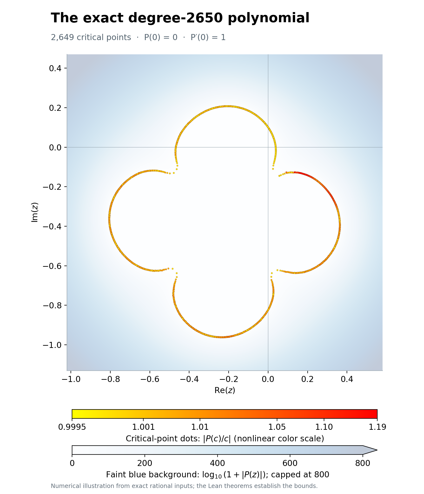
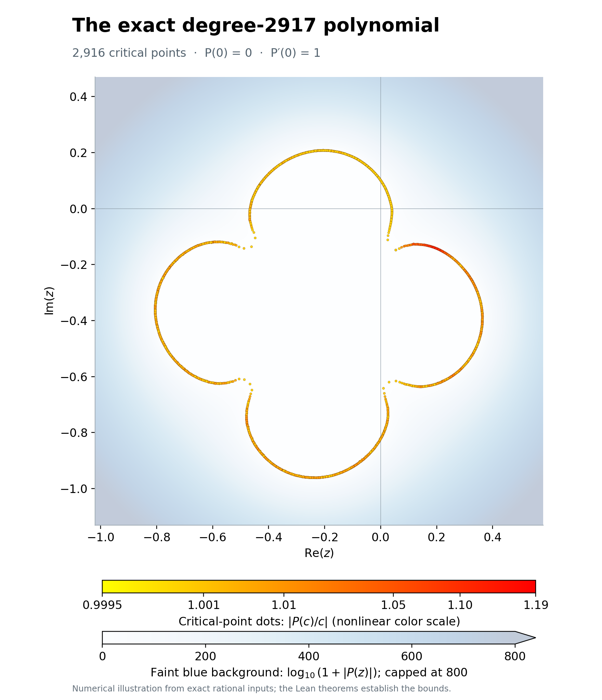

# Explicit MVC counterexamples, proved in Lean

This repository gives specific polynomial counterexamples to Smale's Mean Value Conjecture (MVC), with exact coefficients and proofs in Lean.

The mean value problem asks: how small can we make $K$ so that, for **every** complex polynomial $P$ of degree $N\ge2$ and **every** point $z$ with $P'(z)\ne0$, there is **at least one critical point** $c$ (meaning $P'(c)=0$) such that

$$
\left|\frac{P(z)-P(c)}{z-c}\right|\le K|P'(z)|?
$$

The MVC claims that $K=1$ works. A stronger version claims that the smallest constant $K_N$ that works for every polynomial of exact degree $N$ is

$$
K_N=\frac{N-1}{N}.
$$

A [Lean disproof published in tadamcz's repository](https://github.com/tadamcz/mean-value-problem), from a September 2026 evaluation run, showed that the constant-one conjecture is false. Its construction gives a counterexample of unspecified large degree.

On October 15, 2026, [Jatar and Ng's preprint](https://arxiv.org/abs/2610.21472) established the lower bound $\sqrt{8081/6656}\approx1.1018586788$ for the universal constant. It also showed that polynomials of arbitrarily large degree can exceed $1.1018$.

Here we give two exact polynomials that establish

$$
K_{2650}>\frac{99964059}{100000000}>\frac{2649}{2650},
\qquad
K_{2917}>\frac{1000000129}{1000000000}>1.
$$

In addition, we prove that:

- The strong conjecture fails at every degree $N\ge2650$.
- The constant-one conjecture fails at every degree $N\ge2917$.

I will continue to investigate:
- Which smaller degrees contain counterexamples.
- What the simplest failing polynomial looks like.

## Results

We work at $z=0$ and normalize the polynomials so that $P(0)=0$ and $P'(0)=1$. Define

$$
S(P)=\min_{P'(c)=0}\left|\frac{P(c)}c\right|.
$$

This is the **smallest** critical quotient. To break a bound $T$, every critical point must have a quotient greater than $T$: one small value is enough to spoil the counterexample. In this normalization, $K_N$ is the supremum of $S(P)$ over all polynomials of degree $N$.

The four public results are in [`Mvc/Results.lean`](Mvc/Results.lean):

| Result | Lean theorem |
|---|---|
| Every exact degree $N\ge2650$ has a counterexample to $(N-1)/N$ | `Mvc.Results.every_degree_ge_2650` |
| Every exact degree $N\ge2917$ has a counterexample to $1$ | `Mvc.Results.every_degree_ge_2917` |
| The stated degree-2650 polynomial beats $2649/2650$ at every critical point | `Mvc.Results.explicit_degree_2650` |
| The stated degree-2917 polynomial beats $1$ at every critical point | `Mvc.Results.explicit_degree_2917` |

The guaranteed margins are small but strictly positive: more than $95127/5300000000\approx0.00001795$ above the degree bound for the first example, and more than $0.000000129$ above one for the second.

## The exact polynomials

Instead of printing thousands of expanded coefficients, we specify the roots of the derivative. Given the supplied nonzero numbers $c_1,\ldots,c_{N-1}$, define

$$
q_N(z)=\prod_{j=1}^{N-1}(z-c_j),\qquad
\boxed{P_N(z)=\frac1{q_N(0)}\int_0^z q_N(t)\,dt.}
$$

The integral just means integrating a polynomial term by term, with constant term zero. Dividing by $q_N(0)$ makes $P_N'(0)=1$. This recipe determines every coefficient exactly, and the critical points are precisely the listed $c_j$, including any repetitions.

The definitions are here:

- [`Mvc.Data.degree2650`](Mvc/Data/Degree2650.lean): all 2649 critical points.
- [`Mvc.Data.degree2917`](Mvc/Data/Degree2917.lean): all 2916 critical points.
- [`Mvc.Witnesses.polynomial2650`](Mvc/Witnesses/Degree2650.lean) and [`Mvc.Witnesses.polynomial2917`](Mvc/Witnesses/Degree2917.lean): the polynomials built from those lists.

An entry `⟨a, b, m⟩ : RationalComplex` means exactly $c=a/m+i\,b/m$, with integer numerators and a positive integer denominator. Thus every coefficient belongs to $\mathbb Q(i)$: its real and imaginary parts are rational. Lean proves the degree, normalization, and complete list of critical points; there is no assumption that a numerical rootfinder found them all.

The JSON coordinates under [`witnesses/`](witnesses/) provide another readable copy. A [Lean transcription audit](Tools/AuditData.lean) compares them with the Lean lists using exact integer arithmetic. The proofs use the Lean lists directly and do not depend on parsing JSON.

The plots below show both polynomials on the complex plane. Each critical point $c$ is a dot, colored from yellow to red by the **magnitude** $|P(c)/c|$, the quantity used in the MVC bound. The faint blue background shows the polynomial's magnitude as $\log_{10}(1+|P(z)|)$, so its very large range fits on one color scale. Both plots use the same axes and color scales; the dot scale is nonlinear to distinguish values close to one, and the background scale is capped at 800. Nearby dots can overlap.





These are numerical illustrations, generated from the exact rational coordinates using [the plotting script](Tools/PlotWitnesses.py) with 16000-bit arithmetic. They are separate from the Lean proofs and do not resolve the tiny certified margins visually.

## Why all higher degrees are covered

Suppose a normalized polynomial $P$ beats a fixed bound $L\ge0$ at every critical point. We prove that we can increase its degree to any $M>\deg P$ while keeping that strict inequality. The idea is to add a tiny leading term:

$$
Q_\epsilon(z)=P(z)+\epsilon z^M.
$$

For nonzero $\epsilon$, this has degree exactly $M$. The challenge is controlling **all** its critical points, including the new ones. At any such point $c$,

$$
\frac{Q_\epsilon(c)}c=H(c),\qquad
H(z)=\frac{P(z)}z-\frac{P'(z)}M.
$$

Here $P(z)/z$ is a polynomial because $P(0)=0$. Since $M>\deg P\ge2$, $H$ is nonconstant. The region where $|H|\le L$ is closed and bounded, and $P'$ has no zeros there. Choosing $\epsilon$ sufficiently small keeps $Q_\epsilon'$ nonzero throughout that region. Its critical points must therefore lie where $|H|>L$, which proves the claim.

[`Extension.lean`](Mvc/Extension.lean) proves this argument; [the longer explanation](docs/DEGREE_EXTENSION.md) gives the details. It proves existence of a suitable perturbation at each degree, rather than computing a particular $\epsilon$ for every degree.

There is one extra step for the strong bound: $(M-1)/M$ increases with $M$, so an example that only beats a number below one covers a limited range. Five proved examples give overlapping ranges:

| Degree | Proved lower bound for $S(P)$ | Degrees covered for the strong bound |
|---:|---:|---:|
| 2650 | $99964059/100000000$ | 2650–2782 |
| 2725 | $9996431/10000000$ | 2725–2801 |
| 2798 | $999649/1000000$ | 2798–2849 |
| 2840 | $249917/250000$ | 2840–3012 |
| 2917 | $1000000129/1000000000$ | Every degree from 2917 onward |

[`Coverage.lean`](Mvc/Coverage.lean) checks that these ranges leave no gaps. The degree-2917 example exceeds one, so it also covers the constant-one bound at every higher degree.

## Build the proofs

The project uses Lean **4.28.0** and mathlib **v4.28.0**, with versions pinned for reproducibility. Install [elan](https://github.com/leanprover/elan), then run:

```sh
lake update
lake exe cache get
sh check.sh
```

To inspect proof dependencies or compare the JSON coordinates with the Lean lists:

```sh
lake env lean Mvc/AxiomAudit.lean
lake env lean --run Tools/AuditData.lean
```

[`Main.lean`](Main.lean) is an optional diagnostic. It runs a calculation and prints the result; the theorem files are what establish the proofs:

```sh
lake env lean --run Main.lean 2650 16000
```

## How Lean checks the bounds

The margins are tiny, so ordinary floating-point calculations would not be enough. We use intervals whose endpoints are integers divided by $2^{16000}$. Each arithmetic operation rounds outward, keeping the exact answer inside the interval. Lean proves that these operations are sound.

Write $A(z)=\int_0^z q(t)\,dt$, so that $P(c)/c=A(c)/(q(0)c)$. For every listed critical point, the computation establishes

$$
|A(c)|^2>T^2|q(0)c|^2
$$

by comparing a lower bound on the left with an upper bound on the right. Since $q(0)c\ne0$ and $T\ge0$, this proves $|P(c)/c|>T$. Overlapping intervals would not count as success.

For readers following the code:

| Files | What they establish |
|---|---|
| [`Polynomial.lean`](Mvc/Polynomial.lean) | The exact construction, degree, normalization, and all critical points |
| [`Interval.lean`](Mvc/Interval.lean), [`ComplexBox.lean`](Mvc/ComplexBox.lean), [`RationalComplex.lean`](Mvc/RationalComplex.lean) | Correct interval arithmetic for real and complex numbers |
| [`Coefficients.lean`](Mvc/Coefficients.lean) | Agreement between coefficient-list calculations and mathematical polynomials |
| [`Computation.lean`](Mvc/Computation.lean), [`Checker.lean`](Mvc/Checker.lean) | The calculation and the proof that passing it implies the required bound |
| [`Witnesses/`](Mvc/Witnesses/) | Successful calculations for the five exact polynomials |
| [`Extension.lean`](Mvc/Extension.lean), [`Coverage.lean`](Mvc/Coverage.lean), [`Results.lean`](Mvc/Results.lean) | The higher-degree argument and final results |


[`CheckerControls.lean`](Mvc/CheckerControls.lean) also checks small examples by kernel computation, including rejecting exact equality, a zero critical point, and a zero target denominator.
